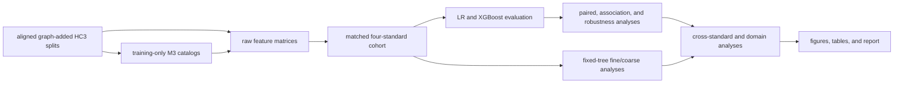

# Repository refactor and artifact migration plan

Prepared and executed 2026-09-17. This plan keeps the matched four-standard HC3 experiment
reproducible while moving obsolete utilities and side studies out of the active
workflow. OOD and Human Detectors results are archival material and are not
part of the experimental outcome.

## Execution status

The active scripts now live under `scripts/prepare`, `scripts/canonical`, and
`scripts/review`; shared imports use normal Python packages. The canonical
driver and configuration are `run_canonical.py` and `configs/canonical.json`.
The verified result is under `artifacts/canonical`, regenerable raw matrices
are under `artifacts/work`, and side material is indexed by
`archive/manifest.json`. The post-migration replay and canonical verification
both completed successfully.

## Refactor boundary

The active repository should answer one question: how do PCC, full eRST, full
RST-DT, and NLDT change motif-level measurements when evaluated on identical
HC3 documents? The reproducible path is:



The active run must not read from archived artifact directories. Every stage
must accept its inputs and output root explicitly, and the run manifest must
record paths, hashes, parameters, environment versions, and row counts.

## Target layout

```text
.
├── README.md
├── requirements.txt
├── configs/
│   └── canonical.json
├── scripts/
│   ├── prepare/                 # parsing, alignment, graphs, M3 catalogs/distributions
│   ├── canonical/               # matrices through final report
│   └── review/                  # optional qualitative case rendering/notes
├── tos/
│   ├── unirst.py
│   ├── tos_dataset.py
│   └── analysis/                # shared modeling, bootstrap, mapping, and I/O code
├── data/
│   ├── unirst2/                 # aligned final graph + M3 records
│   └── motifs2/                 # training-only catalogs and provenance
├── artifacts/
│   ├── canonical/               # frozen, paper-facing evidence
│   │   ├── manifest.json
│   │   ├── feature_matrices/
│   │   ├── model_comparison/
│   │   ├── paired_comparison/
│   │   ├── motif_associations/
│   │   ├── robustness/
│   │   ├── cross_standard_mapping/
│   │   ├── granularity/
│   │   ├── motif_distributions/
│   │   ├── domain_distinctions/
│   │   ├── figures/
│   │   └── report.md
│   └── work/                    # regenerable raw matrices, caches, and temporary models
├── archive/
│   ├── README.md
│   ├── manifest.json
│   ├── code/
│   │   ├── original_acl2024/
│   │   ├── superseded/
│   │   ├── side_studies/
│   │   └── one_off_utilities/
│   └── artifacts/
│       ├── superseded/
│       ├── exploratory/
│       ├── external_evaluation/
│       └── legacy_detector/
└── tests/
    ├── unit/
    └── integration/
```

Large parse intermediates should live in a checksummed cold-data archive rather
than `archive/` inside Git. The checked-in archive manifest should contain their
relative paths, sizes, SHA-256 values, storage location, and restoration command.

## Active code

Retain these functions in the active workflow, initially through compatible
command-line wrappers:

| Stage | Current entry points | Target area |
|---|---|---|
| Prepare aligned inputs | `0_prepare_and_parse_datasets_unirst.py`, `one_time_align_unirst_to_paper_splits.py`, `1_add_graphs_to_unirst_datasets.py`, `2_extract_single_triads.py`, `5_add_motif_dists_to_unirst_datasets.py` | `scripts/prepare/` |
| Build matrices and matched cohort | `11_build_unirst2_feature_matrices.py`, `40_prepare_unirst2_canonical_cohort.py` | `scripts/canonical/` |
| Fit and compare models | `12_evaluate_unirst2_feature_models.py`, `13_compare_unirst2_paired_performance.py` | `scripts/canonical/` |
| Motif evidence | `14_analyze_unirst2_motif_associations.py`, `15_run_unirst2_robustness_analysis.py`, `16_map_unirst2_cross_standard_motifs.py` | `scripts/canonical/` |
| Supporting analyses | `26_compare_unirst2_motif_distributions.py`, `28_ablate_unirst2_m3_granularity.py`, `29_analyze_unirst2_domain_motif_distinctions.py`, `39_ablate_full_erst_granularity.py` | `scripts/canonical/` |
| Figures and synthesis | `17_visualize_unirst2_results.py`, `41_synthesize_unirst2_canonical_results.py` | `scripts/canonical/` |
| Qualitative audit | `18_audit_unirst2_complementarity_cohort.py`, `20_align_unirst2_discourse_representations.py`, `22_audit_unirst2_measurements.py`, `23_extract_unirst2_representation_contrasts.py`, `24_prepare_unirst2_blinded_review.py`, `25_render_unirst2_review_graphs.py`, `rst_graph_visualizer.py`, and the note extraction/formatting utilities | `scripts/review/` |

Before moving the wrappers, extract their filename-based imports into
`tos/analysis/`. In particular, scripts 15, 28, and 39 currently load scripts
12–14 by path. Moving them first would break execution from the repository root.

## Archive disposition

The dedicated `archive/` folder may hold small scripts, reports, manifests, and
compact side results. Each subdirectory gets a README stating its status, last
valid inputs, known limitation, and active replacement.

| Archive destination | Current material |
|---|---|
| `archive/code/original_acl2024/` | `0_prepare_and_parse_datasets.py`, `1_add_graphs_to_datasets.py`, `5_add_motif_dists_to_datasets.py`, `6_split_hc3_dataset.py`, plus their legacy documentation |
| `archive/code/superseded/` | scripts 10, 27, 30, 33–36 and obsolete PCC-alignment/importance/realignment scripts |
| `archive/code/side_studies/` | scripts 3, 4, 7–9, 19, 21, 31, 32, 37, 38, `experiments.ipynb`, and `benchmarks/benchmark_motifs.py` |
| `archive/code/one_off_utilities/` | `adjust_json_file.py`, `merge_motifs.py`, and obsolete alignment/plot utilities after their outputs are frozen |
| `archive/artifacts/superseded/` | `unirst2_coarse_comparison`, old six-condition feature/model/paired/association/robustness/mapping/visual directories, root-level dependency reports, and old importance plots |
| `archive/artifacts/exploratory/` | `unirst2_complementarity`, `unirst2_localized_ablation`, and `unirst2_minimal_contribution` |
| `archive/artifacts/external_evaluation/` | `unirst2_ood_coarse_comparison` and `unirst2_human_detectors` |
| `archive/artifacts/legacy_detector/` | legacy Longformer outputs and M6/M9 result bundles |

Do not archive `history.py`; keep it ignored and remove it from any publication
snapshot because it is an interactive history rather than research source.

## Canonical artifact contract

`artifacts/canonical` is the only source used by the paper-facing reports. It
contains the common-cohort matrices and compact outputs needed to verify each
claim. Reproducible but bulky inputs to the common-cohort step belong under
`artifacts/work/raw_feature_matrices`.

The canonical manifest must include:

- the four inventory names and exact train, validation, and test identities;
- SHA-256 hashes for aligned input records, catalogs, mappings, matrices,
  predictions, tables, and figures;
- software and platform versions, random seeds, bootstrap counts, and model
  parameters;
- the command and configuration used for every stage;
- explicit parent artifacts for every output;
- the expected headline values used by the verification command.

Use atomic writes and refuse to overwrite a frozen canonical directory unless
the caller supplies a new run identifier or `--force`.

## One canonical entry point

Add `run_canonical.py` with these commands:

```text
python run_canonical.py build --config configs/canonical.json
python run_canonical.py resume --config configs/canonical.json
python run_canonical.py verify --artifact-root artifacts/canonical
python run_canonical.py report --artifact-root artifacts/canonical
```

`build` runs raw matrix creation, common-cohort alignment, models, comparisons,
fixed-tree ablations, mappings, domain analyses, figures, and synthesis in
dependency order. `resume` skips only outputs whose manifest hashes and parent
hashes match. `verify` performs no fitting and fails on a missing input, wrong
inventory, identity mismatch, stale parent hash, or changed headline result.
`report` regenerates Markdown from verified CSV/JSON outputs.

The configuration should centralize the inventory list, data/catalog roots,
coarse mapping files, seeds, bootstrap settings, worker counts, and output
roots. Scripts should no longer encode divergent artifact defaults.

## Migration sequence

1. **Freeze the current result.** Generate a snapshot manifest for
   `artifacts/unirst2_canonical`, `data/motifs2`, the four final aligned input
   sets, coarse mappings, reports, and environment. Record current headline
   values as verification expectations.
2. **Extract shared analysis code.** Move reusable loaders, model fitting,
   bootstrap inference, hashing, atomic output, and mapping functions to
   `tos/analysis/`. Keep the current scripts working as thin wrappers and run
   their targeted tests after each extraction.
3. **Add the configuration and driver.** Make `run_canonical.py` pass every path
   explicitly. Build raw matrices in `artifacts/work`, then create the matched
   cohort in a fresh candidate canonical directory.
4. **Perform a clean replay.** Run from the final aligned M3 records and catalogs
   without reading any old top-level artifact directory. Compare identities,
   table rows, estimates, confidence intervals, and figure inventories with the
   frozen snapshot.
5. **Promote the replay.** Rename the verified candidate to
   `artifacts/canonical`, update report image links, README commands, tests, and
   `.gitignore`, then run `verify` and `report` once more.
6. **Move code into the target layout.** Preserve compatibility shims for one
   release or update every import and documented command in the same change.
7. **Move side material to `archive/`.** Generate `archive/manifest.json` before
   moving anything. Recalculate hashes afterward and ensure no active script or
   report references an archived path.
8. **Archive large data separately.** Package superseded parses and bulky model
   outputs only after archive checksum verification and a successful replay
   with the archive unavailable.
9. **Final boundary test.** In a clean checkout with restored canonical inputs,
   run unit tests, the canonical verification command, report regeneration, and
   a small end-to-end smoke run. Document runtime, peak disk use, and required
   external downloads.

## Acceptance criteria

The refactor is complete when:

- one documented command reconstructs the main four-standard analysis;
- the run uses 43,322 train, 968 validation, and 1,932 test identities in the
  same order for all standards;
- regenerated model, paired, association, granularity, mapping, domain, figure,
  and report outputs pass manifest verification;
- `UNIRST2_RESEARCH_REPORT.md` and `PAPER_RELEVANT_RESULTS_TABLES.md` depend only
  on `artifacts/canonical`;
- no active module imports a numbered script by filesystem path;
- no active workflow reads from `archive/` or old top-level artifact folders;
- the archive manifest can account for every moved file and name its active
  replacement or archival reason;
- OOD and Human Detectors outputs remain outside the reported experimental
  outcomes.

No files should be deleted during the migration. Deletion or external cold
storage should be considered only after the new canonical run passes these
criteria and all archived files have verified checksums.
