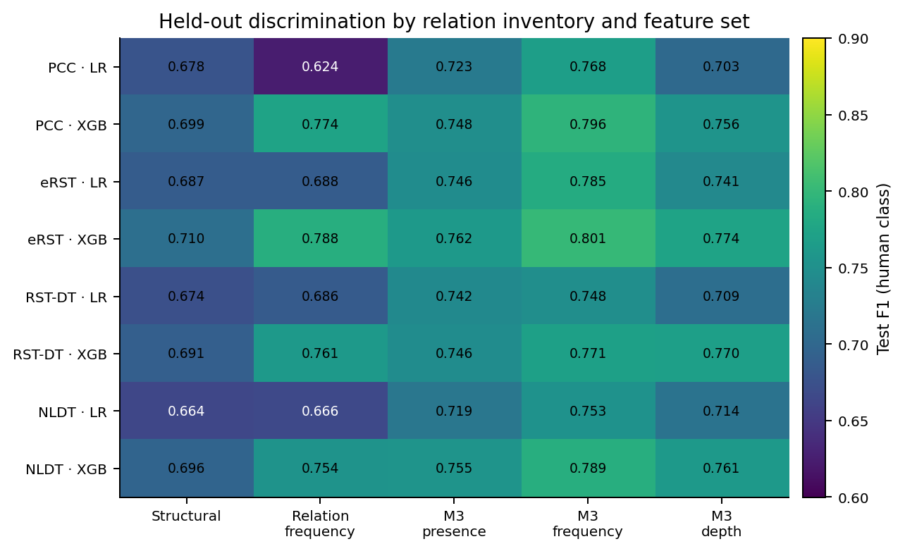
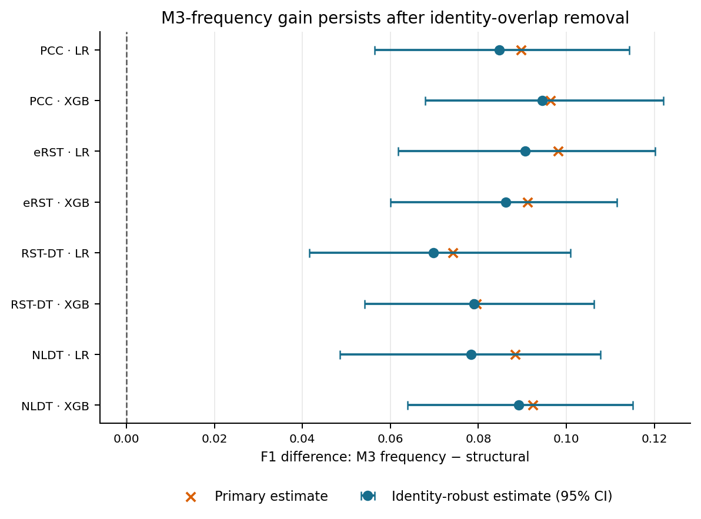
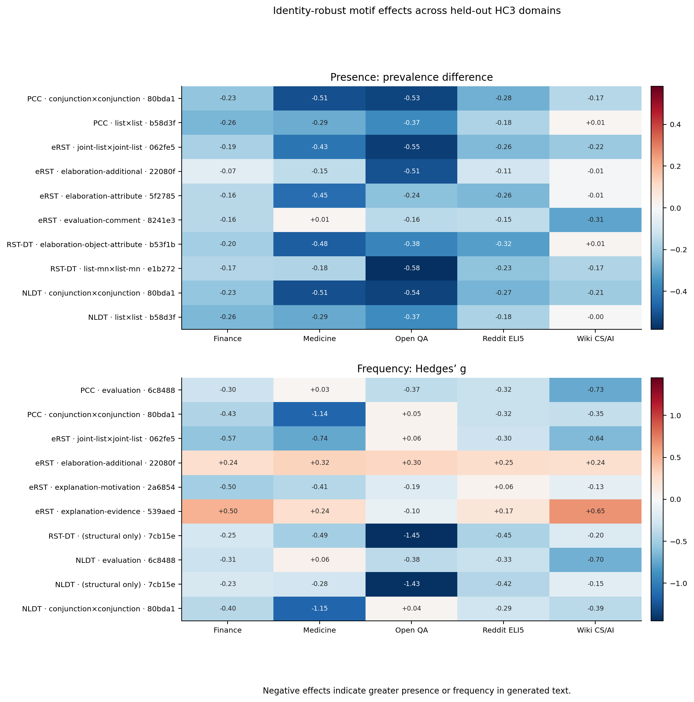
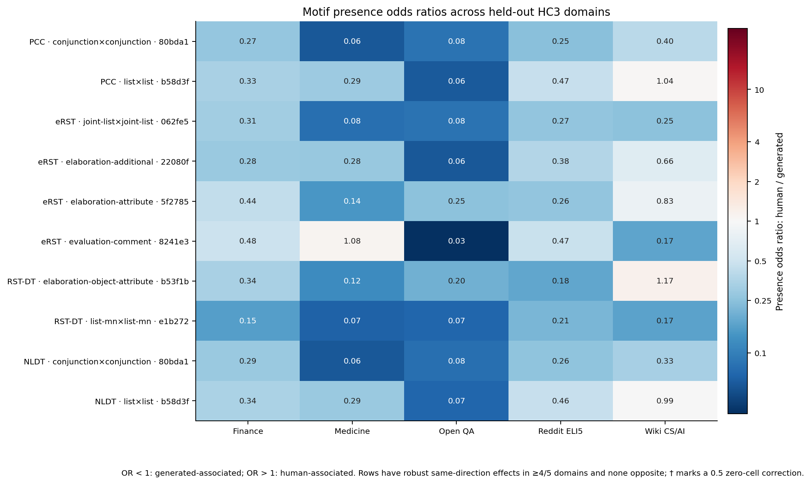
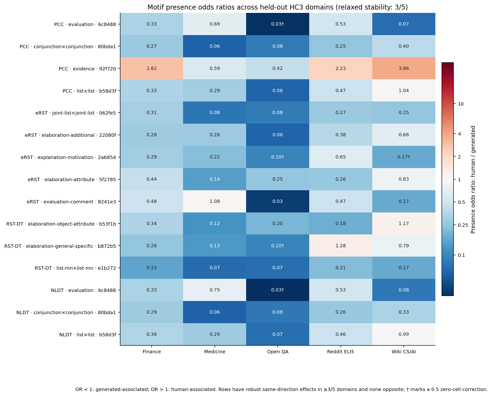
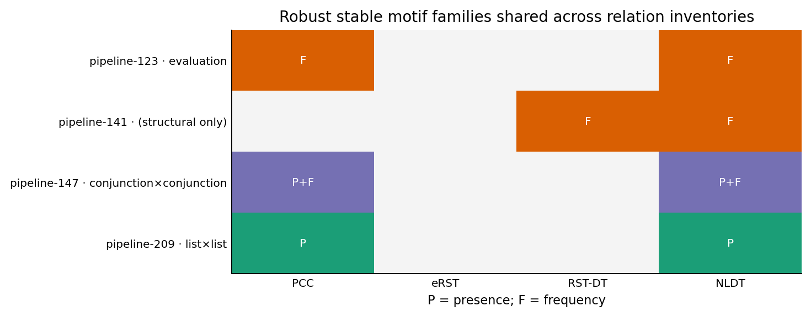

# Canonical UniRST2 four-standard research report

## Executive summary

The consolidated experiment compares PCC, full eRST, full RST-DT, and NLDT on exactly the same train, validation, and test identities and on a shared EDU segmentation target. This removes segmentation as a source of cross-standard variation in the primary comparison.

M3-frequency XGBoost test F1 ranges from 0.771 to 0.801. Against structural features, its paired F1 gain ranges from 0.080 to 0.096.

The fixed-tree LR MF+WAD projection gives a fine-minus-coarse F1 difference of +0.032 to +0.081; the Kim-style RF MF+WAD comparison gives +0.006 to +0.028.

The stable-association screen finds 19 stable candidate–representation associations: 12 presence, 7 frequency, and 0 conditional-depth effects.

## Canonical design

The common cohort contains 43,322 train, 968 validation, and 1,932 test documents. Identity order and labels are exact across all four matrices. Catalogs remain training-only. Binary F1 for label 1 (human) is reported for comparability with Kim et al. LR/XGBoost models use validation ROC-AUC selection and validation-only thresholds; the Kim-style fine/coarse random forests use the fixed 0.5 threshold.

## Predictive results

| Standard | Model | Structural | Relation frequency | M3 presence | M3 frequency | M3 depth |
|---|---|---:|---:|---:|---:|---:|
| PCC | LR | 0.678 | 0.624 | 0.723 | 0.768 | 0.703 |
| PCC | XGB | 0.699 | 0.774 | 0.748 | 0.796 | 0.756 |
| eRST | LR | 0.687 | 0.688 | 0.746 | 0.785 | 0.741 |
| eRST | XGB | 0.710 | 0.788 | 0.762 | 0.801 | 0.774 |
| RST-DT | LR | 0.674 | 0.686 | 0.742 | 0.748 | 0.709 |
| RST-DT | XGB | 0.691 | 0.761 | 0.746 | 0.771 | 0.770 |
| NLDT | LR | 0.664 | 0.666 | 0.719 | 0.753 | 0.714 |
| NLDT | XGB | 0.696 | 0.754 | 0.755 | 0.789 | 0.761 |

## Paired representation effects

| Standard | Model | M3 frequency − structure F1 | 95% CI | Holm-adjusted value |
|---|---|---:|---:|---:|
| PCC | LR | +0.090 | [+0.062, +0.118] | 0.0070 |
| PCC | XGB | +0.096 | [+0.072, +0.123] | 0.0070 |
| eRST | LR | +0.098 | [+0.070, +0.126] | 0.0070 |
| eRST | XGB | +0.091 | [+0.066, +0.118] | 0.0070 |
| RST-DT | LR | +0.074 | [+0.045, +0.103] | 0.0070 |
| RST-DT | XGB | +0.080 | [+0.053, +0.106] | 0.0070 |
| NLDT | LR | +0.088 | [+0.059, +0.118] | 0.0070 |
| NLDT | XGB | +0.092 | [+0.068, +0.117] | 0.0070 |

## Fixed-tree granularity

LR with MF and MF+WAD

| Standard | Representation | Fine F1 | Coarse F1 | Fine − coarse (95% CI) | Holm-adjusted p |
|---|---|---:|---:|---:|---:|
| PCC | MF | 0.768 | 0.687 | +0.081 [+0.061, +0.102] | 0.0040 |
| PCC | MF_WAD | 0.774 | 0.716 | +0.057 [+0.040, +0.076] | 0.0040 |
| eRST | MF | 0.785 | 0.729 | +0.056 [+0.035, +0.078] | 0.0040 |
| eRST | MF_WAD | 0.778 | 0.697 | +0.081 [+0.057, +0.104] | 0.0040 |
| RST-DT | MF | 0.748 | 0.746 | +0.002 [-0.014, +0.019] | 0.8226 |
| RST-DT | MF_WAD | 0.770 | 0.739 | +0.032 [+0.013, +0.050] | 0.0040 |
| NLDT | MF | 0.753 | 0.696 | +0.057 [+0.037, +0.076] | 0.0040 |
| NLDT | MF_WAD | 0.766 | 0.702 | +0.064 [+0.046, +0.084] | 0.0040 |

Paired change in the fine-minus-coarse gain after adding WAD:

| Standard | (MF+WAD gain) − (MF gain), F1 (95% CI) | Holm-adjusted p |
|---|---:|---:|
| PCC | -0.024 [-0.044, -0.003] | 0.0660 |
| eRST | +0.025 [+0.004, +0.044] | 0.0660 |
| RST-DT | +0.029 [+0.012, +0.049] | 0.0080 |
| NLDT | +0.007 [-0.011, +0.027] | 0.4498 |

The paired MF versus MF+WAD contrast estimates whether adding depth changes LR's fine-minus-coarse gain. Both use the same model selection, threshold selection, matched test identities, and bootstrap resamples.

Kim-style RF with MF+WAD

| Standard | Fine MF+WAD F1 | Coarse MF+WAD F1 | Fine − coarse (95% CI) | Holm-adjusted p |
|---|---:|---:|---:|---:|
| PCC | 0.778 | 0.751 | +0.028 [+0.011, +0.047] | 0.0160 |
| eRST | 0.795 | 0.775 | +0.021 [+0.003, +0.039] | 0.0840 |
| RST-DT | 0.780 | 0.771 | +0.009 [-0.008, +0.026] | 0.6457 |
| NLDT | 0.763 | 0.757 | +0.006 [-0.011, +0.024] | 0.6457 |

The RF comparison follows Kim et al.'s motif-classifier feature construction and uses a fixed 0.5 threshold. Coarse WAD is occurrence-weighted from its merged fine motifs. Across both LR representations and RF, documents, segmentation, tree topology, attachments, nuclearity handling, and motif occurrence mass remain fixed; only relation labels and projected motif dimensions change.

## Stable motif associations

| Standard | Presence | Frequency | Conditional depth |
|---|---:|---:|---:|
| PCC | 3 | 1 | 0 |
| eRST | 4 | 3 | 0 |
| RST-DT | 2 | 1 | 0 |
| NLDT | 3 | 2 | 0 |

The table summarizes the primary test cohort. The following figures use the identity-clean sensitivity cohort and its stability screen.

The odds ratios compare motif-presence odds in human and generated documents within each domain. The color scale is centered on OR = 1; a 0.5 count correction is applied only if a two-by-two table has a zero cell.

The relaxed sensitivity view requires robust same-direction presence effects in at least three of five domains, with no robust effect in the opposite direction; it is not a replacement for the primary stability screen.

## Cross-standard and domain interpretation

The catalogs contain 395 inventory-specific motifs. Exact relation-labelled overlap is strongest between inventories that share labels, while all four standards occupy common relation-agnostic structural families. Domain analysis retained 47 robust identity-clean interactions, with 4 recurring exact-label families across multiple standards. Thus the standards largely agree on structural templates while assigning much of the discriminative detail through inventory-specific relation distinctions.

## Conclusions

1. Local discourse motifs contribute information beyond document-scale structure across all four standards.
2. For Kim-style RF, MF+WAD fine-minus-coarse gains are positive in all standards; pointwise intervals exclude zero for PCC and eRST, while only PCC survives Holm correction. For LR with MF+WAD, Holm-adjusted tests support positive gains in PCC, eRST, RST-DT, and NLDT.
3. Stable signal is associated with motif occurrence and frequency, not conditional depth.
4. Cross-standard overlap is clearest at the structural-family level; exact relation-labelled motifs are often inventory-specific.
5. These results concern the consequences of measurement choices, not the ontological superiority of a relation inventory.

## Reproducibility

Canonical artifacts are under `artifacts/canonical`. The common-cohort manifest records every source and artifact hash; superseded and side-study outputs are indexed under `archive/`.
