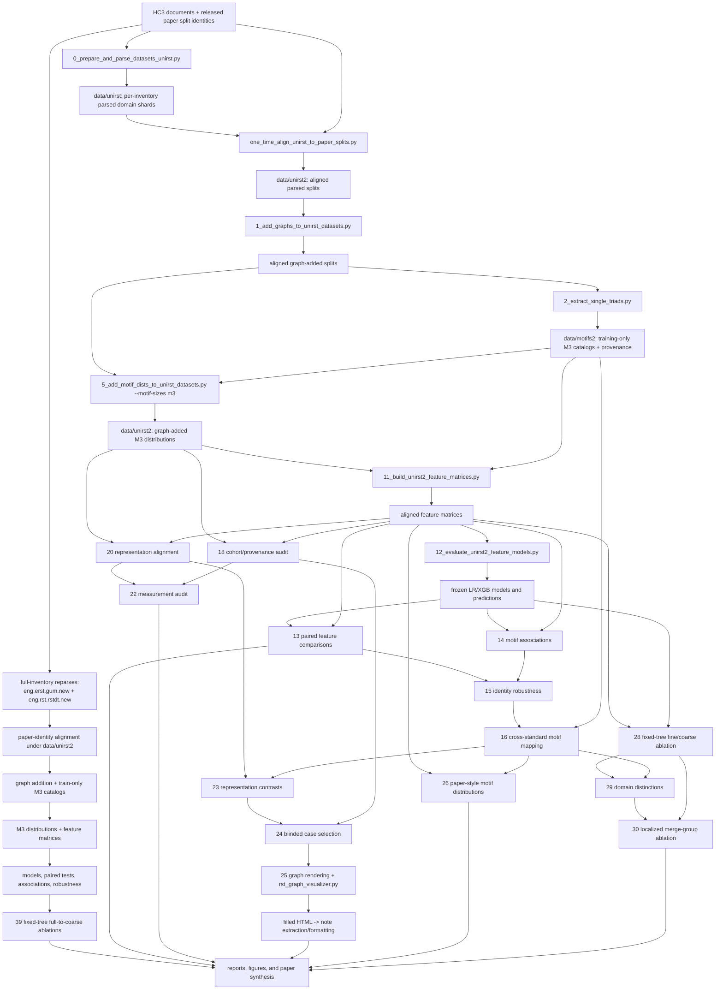
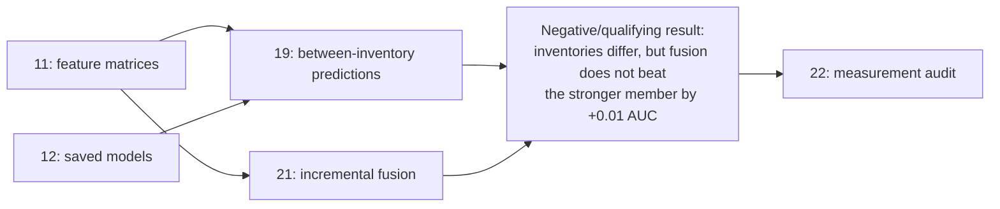
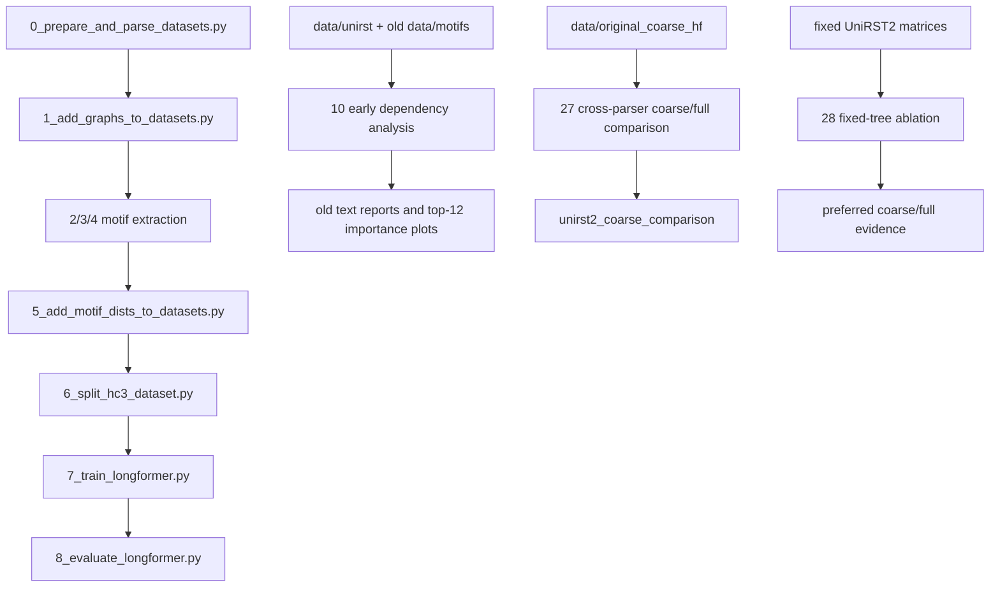

# UniRST2 project flow and archive plan

The executable repository restructuring sequence is specified in
`REPOSITORY_REFACTOR_PLAN.md`. This document retains the detailed provenance
audit and scientific branch history.

Prepared 2026-09-13 and updated 2026-09-17 from the scripts, default paths,
manifests, reports, and current disk contents. This document proposes an
archive boundary; it does not authorize deletion or move any files.

## Objective used for the audit

The main objective is to test whether PCC, GUM/eRST, RST-DT, and NLDT provide
overlapping but meaningfully different measurements of discourse coherence.
Authorship prediction is supporting evidence. Faithful reproduction of the
original detector, M6/M9 scaling, and further Longformer optimization are not
part of the shortest path to that objective.

## Canonical flow

The final `*.graph_added.m3_motif_dists.jsonl` records contain the text,
scenes, discourse graphs, and M3 distributions. Within `data/unirst2`, the
earlier `*.discourse_parsed.jsonl` and `*.graph_added.jsonl` files are therefore
intermediate copies rather than independent analytical inputs.

The two `.new` inventories are a validation branch for testing whether results
survive the parsers' full relation inventories. Their raw parses were produced
with newer schema-v2 segmentation caches, so direct old-versus-new feature
comparisons do not isolate relation granularity. The primary granularity test
therefore collapses labels and motifs on each `.new` inventory's fixed trees.
This design is implemented by script 39 and removes the segmentation/tree
confound from the fine-versus-coarse contrast.

## Current execution state (2026-09-17)

- `eng.erst.gum.new` and `eng.rst.rstdt.new` have paper-aligned HC3 splits,
  graph-added files, training-only M3 catalogs, projected M3 distributions,
  feature matrices, fitted models, paired comparisons, association results,
  and robustness outputs.
- Full RST-DT contains 43,684 train, 996 validation, and 1,998 test graph-added
  records. Its catalog contains 161 M3 motifs.
- The fixed-tree RST-DT ablation maps 61 observed relation features to 19 coarse
  features and 161 M3 motifs to 68 coarse motifs. All mappings are complete and
  preserve relation and motif mass.
- Full RST-DT improves test ROC-AUC over its fixed-tree coarse counterpart in
  all eight representation/classifier comparisons. Gains range from 0.012 to
  0.054, and all paired 95% bootstrap intervals exclude zero after Holm
  correction. M3-frequency XGBoost is the strongest full model at 0.881 ROC-AUC.
- The operational RST-DT mapping is stored in
  `docs/eng.rst.rstdt.new_to_coarse.json`. Its theoretically consequential
  assignments still require independent RST-informed validation.
- Script 40 constructs the canonical four-way common cohort: 43,319 train, 968
  validation, and 1,931 test documents. Scripts 12–17, 26, 28, 29, and 39 have
  been rerun under `artifacts/unirst2_canonical`; script 41 regenerates the
  paper tables and research report from those artifacts.

## Supporting branch, not the central claim

Scripts 19 and 21 answer the former detector-complementarity question. Their
negative result is useful context, but neither is required to establish that
the inventories expose different, linguistically defensible distinctions.
Keep their compact reports and tables in the paper record; move their fitted
models and large case tables to the secondary archive after conclusions are
frozen.

## Legacy and superseded branches

Script 27 does not isolate relation granularity because the coarse and full
features come from different parsers/catalogs. Scripts 28 and 39 supersede it
for the scientific claim: script 28 covers the original aligned inventories,
while script 39 now supports full eRST and full RST-DT through fixed-tree
relation mappings. Scripts 3 and 4 and their M6/M9 outputs address scale and
storage questions that the current M3-only objective no longer needs.

## Script disposition

| Disposition | Scripts | Reason |
|---|---|---|
| Keep: upstream provenance | `0_prepare_and_parse_datasets_unirst.py`, `1_add_graphs_to_unirst_datasets.py`, `2_extract_single_triads.py`, `5_add_motif_dists_to_unirst_datasets.py`, `one_time_align_unirst_to_paper_splits.py`, `tos/` | Recreates the aligned UniRST inputs used by the current analyses. |
| Keep: core quantitative path | `11`–`17`, `26`, `28`, `29`, `39`–`41` | Produces the canonical common cohort, principal models, motif associations, cross-standard mapping, figures, granularity/domain evidence, and paper synthesis. Keep `docs/eng.rst.rstdt.new_to_coarse.json` with script 39. |
| Keep: review path | `24`, `25`, `rst_graph_visualizer.py`, `one_time_extract_filled_case_notes.py`, `one_time_format_filled_case_notes.py` | Preserves the auditable passage review and human notes. |
| Keep but label secondary | `17`, `19`, `21` | Figures and the negative predictive-fusion result remain useful context, but are not the central linguistic claim. |
| Archive as superseded | `10_analyze_motif_label_dependency.py`, `27_compare_coarse_and_full_m3.py`, `one_time_align_hc3_splits_to_pcc.py`, `one_time_plot_m3_importance.py`, `one_time_realign_motif_distributions.py` | Replaced respectively by scripts 11–17/26/29, fixed-tree script 28, released-paper alignment, current association figures, and corrected ordered outputs. Retain provenance, not active entry points. |
| Archive as out of scope | `3_extract_double_triads.py`, `4_extract_triple_triads.py`, `7_train_longformer.py`, `8_evaluate_longformer.py`, `9_prepare_and_parse_ood_sets.py`, `31_compare_unirst2_coarse_full_ood.py`, `32_analyze_unirst2_ood_domains.py`, `37_evaluate_human_detectors_holdout.py`, `38_compare_human_detectors_motif_distributions.py`, `experiments.ipynb`, `benchmarks/benchmark_motifs.py` | M6/M9, Longformer optimization, and external-transfer branches are outside the repaired canonical experiment. |
| Preserve as original-repo legacy | `0_prepare_and_parse_datasets.py`, `1_add_graphs_to_datasets.py`, `5_add_motif_dists_to_datasets.py`, `6_split_hc3_dataset.py` | Useful for the ACL 2024 baseline, but should be documented outside the active UniRST2 workflow. |
| Quarantine, then remove | `adjust_json_file.py`, `merge_motifs.py`, `history.py` | Ad-hoc utilities have no declared current output; `history.py` is raw interactive history, invalid as project source, and may expose local details. Do not publish it. |

The numbered scripts are not independent modules. Scripts 15, 19, 21, 28,
30, 31, and 39 dynamically load helpers from scripts 12–14; scripts 22 and 23
load script 20; script 25 loads script 24. Do not move any of these dependencies
individually. Either keep them together or first extract shared functions into
`tos/analysis/` and add integration tests.

## Output disposition and storage impact

### Keep active

- `data/motifs2` (416 KiB): canonical training-only M3 catalogs and provenance,
  including the full eRST and RST-DT catalogs.
- `data/unirst2/*/*.graph_added.m3_motif_dists.jsonl`: one
  self-contained graph-and-M3 representation for the aligned train,
  validation, and test records. The complete `data/unirst2` tree is currently
  9.8 GiB because it includes both original and `.new` inventory branches.
- `data/unirst2/hc3_paper_*` (52 MiB): split identities and alignment audit.
- `artifacts/unirst2_feature_matrices`, `unirst2_model_comparison`,
  `unirst2_paired_comparison`, `unirst2_motif_associations`,
  `unirst2_robustness`, and `unirst2_cross_standard_mapping`: reusable
  quantitative foundation.
- `artifacts/unirst2_complementarity/{cohort files,measurement audit,
  representation_alignment,representation_contrasts,human_review}`: validity
  checks and the qualitative evidence chain.
- `artifacts/unirst2_motif_distribution_comparison`,
  `unirst2_granularity_ablation`, `unirst2_domain_distinctions`,
  and `unirst2_localized_ablation`: earlier supporting
  principal results.
- `artifacts/unirst2_canonical`: the active four-standard common-cohort
  matrices, models, comparisons, figures, distribution/domain analyses, and
  fixed-tree ablations. This is now the source for reported outcomes.
- `artifacts/full_erst_granularity_ablation` and
  `artifacts/full_rstdt_granularity_ablation`: fixed-tree full-to-coarse
  validation evidence. The RST-DT bundle is about 14 MiB; retain its
  `results.json` and `fine_vs_coarse.csv` in the paper snapshot, while its
  coarse matrices and fitted models are reproducible.
- `UNIRST2_RESEARCH_REPORT.md`, the revised research plan, and this flow/archive
  plan.

### Move to a secondary results archive

- Root-level old dependency reports and `artifacts/m3_only_xgb_top12_*` plots.
- `artifacts/unirst2_coarse_comparison` (11 MiB), paired with script 27 and
  explicitly labelled **cross-parser/confounded; not primary evidence**.
- `artifacts/unirst2_complementarity/prediction_comparison` and
  `incremental_models` after retaining their reports, manifests, principal
  CSVs, and final prediction bundle in the paper snapshot.
- Fitted per-group models under `artifacts/unirst2_localized_ablation/models`
  after retaining `groups.csv`, `paired_comparisons.csv`, `report.md`, and the
  manifest. They are reproducible from the fixed matrices.
- Fitted models and coarse feature matrices under both
  `artifacts/full_*_granularity_ablation` directories after retaining their
  mapping, results JSON, paired CSV, and provenance hashes.
- One of the two human-review PNG trees. `tree_pngs` and
  `filled_cases_files` contain 120/120 byte-identical images, wasting about
  25 MiB. Preserve the set referenced by the final HTML and archive the other
  with the original blinded package.

### Move to cold data storage

- `data/unirst2/*/*.discourse_parsed.jsonl` and `*.graph_added.jsonl`. They are
  superseded by the final M3 files, but should remain recoverable until a
  clean-room replay verifies this fact. This includes the `.new` inventory
  intermediates and their original per-domain parse shards.
- All superseded intermediates in `data/unirst` once the aligned
  `data/unirst2` hashes have been frozen. Keep the small alignment audit that
  records their provenance.
- `data/motifs` (194 MiB), which belongs to the earlier M3+M6 workflow.
- `data/original_coarse_hf` (784 MiB), which is used only by the superseded
  cross-parser script 27.

The earlier 13 GiB reduction estimate predates the two 2.0 GiB `.new`
inventory branches and must not be used as a deletion target. Recalculate the
active/cold byte totals from the final manifest immediately before archiving.
A compact results-only release can omit reproducible parse intermediates,
coarse matrices, and fitted ablation models, but it would not support replaying
the representation and human-review stages without restoring cold data.

## Safe archive procedure

1. **Freeze the research snapshot.** Commit or tag all intended source files;
   record `git rev-parse HEAD`, environment exports, the released-dataset
   revision, and SHA-256 hashes for every canonical data and artifact file.
2. **Create one active entry point.** Add a small driver or Makefile that runs
   the canonical stages in dependency order and a `--verify-only` mode that
   checks manifests without refitting. Update `README.md` so UniRST2 M3 is the
   primary workflow and move the M6/M9 instructions into a legacy document.
3. **Extract shared code before moving numbered dependencies.** Move reusable
   model, bootstrap, alignment, and HTML-rendering helpers from scripts 12–14,
   20, 24, and 39 into `tos/analysis/`. Preserve command-line wrappers. This avoids
   breaking scripts that currently import other numbered files by filename.
4. **Archive small code reversibly.** Use `archive/code/original_acl2024/`,
   `archive/code/superseded/`, and `archive/code/optional_m6_m9/`, each with a
   README naming its replacement, last valid inputs, outputs, and known
   limitations. Do not rely on filenames alone to convey status.
5. **Archive bulky outputs outside Git.** Place cold data in a versioned
   `tar.zst` or object-store snapshot, generate a checked-in manifest containing
   relative paths, sizes, SHA-256 values, archive URI, and restoration command,
   then verify the archive before removing working copies. Never add the
   currently 21 GiB generated data tree to Git.
6. **Deduplicate, do not discard, the review package.** Preserve the filled
   HTML, its referenced image directory, codebook JSON, notes JSON, sampling
   manifest, and sealed key. Keep the original blinded HTML/JSON and duplicate
   images in the cold audit snapshot or replace duplicate images with verified
   hard links in the local working copy.
7. **Prove the boundary.** Temporarily make the proposed archive unavailable;
   run the core tests, manifest verification, scripts 17 and 26 from saved
   matrices, report regeneration for scripts 28–31 and 39, and HTML rendering
   for a sample case. Compare output hashes or documented numerical summaries.
8. **Remove only after two checks.** Require both archive checksum verification
   and a successful no-archive smoke test. Record the final active and archived
   byte counts. Keep `history.py` out of both the publication repository and
   normal research archives unless it has been reviewed and sanitized.

## Recommended publication snapshot

The paper-facing bundle should expose three layers:

1. **Inputs/provenance:** paper split identities, `data/motifs2`, the reviewed
   fine-to-coarse mapping files, hashes, and a retrieval recipe for the large
   aligned graph records.
2. **Recomputable evidence:** feature matrices, frozen predictions/models,
   compact manifests, CSV tables, review cases, codebook, and selected figures.
3. **Cold provenance:** raw/intermediate parses, optional M6/M9 work,
   cross-parser comparisons, early reports, and exact restoration instructions.

This preserves negative and exploratory work without allowing it to obscure
the central claim: relation inventories are strongly overlapping measurement
systems, but selected fine distinctions—most clearly PCC coordination and
enumeration distinctions—change motif-level authorship evidence across HC3
domains. The full RST-DT fixed-tree result provides an
independent validation that fine inventory distinctions retain predictive
information beyond their coarse parents; it does not establish that those
distinctions are ontologically superior or that the parser itself is better.
