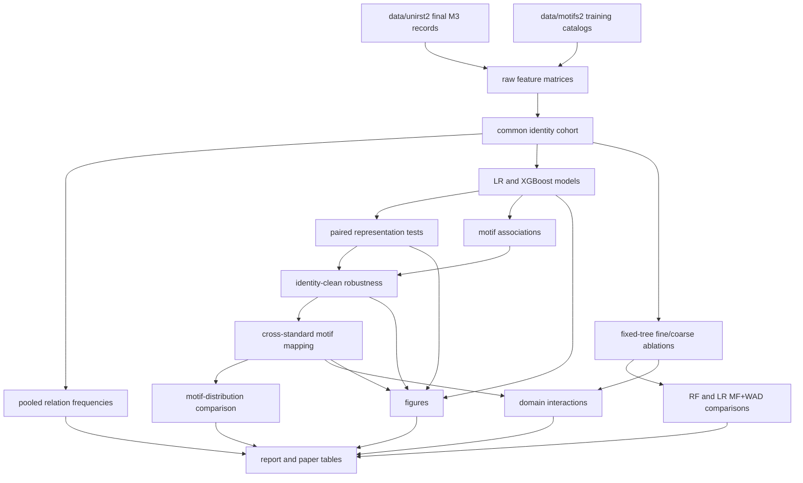

# Canonical UniRST2 pipeline

## Scope

The active experiment compares PCC, full eRST, full RST-DT, and NLDT on the
same HC3 identities. It uses M3 motifs and reports only the matched in-HC3
experiment. Archived external-evaluation and detector branches do not feed the
pipeline or its reports.

For the human-readable findings, see the [research report](../UNIRST2_RESEARCH_REPORT.md)
and [paper-facing tables](../PAPER_RELEVANT_RESULTS_TABLES.md). For repository
navigation and the distinction between tracked snapshots and local-only data,
see the [repository guide](REPOSITORY_GUIDE.md).

## Flow



## Entry point

All paths and numerical settings are defined in `configs/canonical.json`.

```bash
python run_canonical.py resume --config configs/canonical.json
python run_canonical.py verify --config configs/canonical.json
```

Use `build` instead of `resume` to recompute all model and bootstrap stages.
Use `report` to regenerate the Markdown report and tables without fitting.

## Stage modules

| Stage | Module | Output |
|---|---|---|
| Raw matrices | `scripts.canonical.build_feature_matrices` | `artifacts/work/shared_segmentation_raw_feature_matrices` |
| Common cohort | `scripts.canonical.prepare_canonical_cohort` | `artifacts/canonical/feature_matrices` |
| Relation frequencies | `scripts.canonical.aggregate_relation_frequencies` | `artifacts/canonical/relation_frequencies` |
| Models | `scripts.canonical.evaluate_feature_models` | `artifacts/canonical/model_comparison` |
| Paired inference | `scripts.canonical.compare_paired_performance` | `artifacts/canonical/paired_comparison` |
| Associations | `scripts.canonical.analyze_motif_associations` | `artifacts/canonical/motif_associations` |
| Sensitivity | `scripts.canonical.run_robustness_analysis` | `artifacts/canonical/robustness` |
| Mapping | `scripts.canonical.map_cross_standard_motifs` | `artifacts/canonical/cross_standard_mapping` |
| PCC/NLDT ablation | `scripts.canonical.ablate_m3_granularity` | `artifacts/canonical/granularity/pcc_nldt` |
| eRST/RST-DT ablation | `scripts.canonical.ablate_full_inventory_granularity` | `artifacts/canonical/granularity/{erst,rstdt}` |
| RF MF+WAD comparison | `scripts.canonical.compare_rf_granularity` | `artifacts/canonical/granularity/rf_mf_wad` |
| LR MF and MF+WAD comparison | `scripts.canonical.compare_lr_wad_granularity` | `artifacts/canonical/granularity/lr_mf_wad` |
| Distributions | `scripts.canonical.compare_motif_distributions` | `artifacts/canonical/motif_distributions` |
| Domain effects | `scripts.canonical.analyze_domain_motif_distinctions` | `artifacts/canonical/domain_distinctions` |
| Figures | `scripts.canonical.visualize_results` | `artifacts/canonical/figures` |
| Synthesis | `scripts.canonical.synthesize_results` | root reports and `artifacts/canonical/report.md` |

## Shared granularity helpers

`tos.analysis.granularity` defines the inventory-to-output-directory mapping
used by the runner and both MF+WAD comparison stages. It also owns common
fine/coarse identity and motif-mass checks, occurrence-weighted WAD
aggregation, MF/WAD column ordering, identity-clean test selection, and
atomic artifact writes. The PCC/NLDT and eRST/RST-DT scripts retain their
separate relation mappings because those mappings encode different standards.

The raw matrices are deliberately outside the canonical artifact: individual
parsers yield slightly different success cohorts. The cohort stage intersects
their `identity_id` values, checks labels, and writes all four matrices in the
same order.

## Preparation modules

Recreating final M3 records from raw corpora uses, in order:

```text
scripts.prepare.prepare_and_parse_datasets_unirst
scripts.prepare.align_to_paper_splits
scripts.prepare.add_graphs
scripts.prepare.extract_m3
scripts.prepare.add_motif_distributions
```

The relation inventory is part of every path. Catalog extraction uses training
records only, and distribution extraction validates selected hashes against
the corresponding inventory catalog.

## Verification contract

`python run_canonical.py verify` checks:

- 43,322 train, 968 validation, and 1,932 test identities;
- exact membership of the four canonical inventories in central tables;
- expected model, paired-comparison, stability, robustness, RF granularity,
  and LR MF+WAD comparison row counts;
- SHA-256 and byte-size records in the canonical run manifest;
- absence of external-evaluation outcomes from the paper-facing reports.

The canonical run manifest also stores the configuration, Git revision, Python
and platform versions, and headline dimensions. Stage manifests retain model
settings, source hashes, and random seeds.

## Optional qualitative review

The review workflow is packaged under `scripts/review` and writes to
`artifacts/review`. Its alignment, measurement audit, contrast extraction,
case selection, rendering, and note formatting stages remain together so no
active review stage depends on archived code. Historical completed review
bundles are preserved under `archive/artifacts/exploratory`.

## Archive boundary

Active code and reports never read from `archive/`. The optional
`archive/manifest.json` is an ignored, local-only inventory of files present in
the current working copy; it is not checked in and is not a data-restoration
manifest. See `REPOSITORY_REFACTOR_PLAN.md` and `archive/README.md` for the
repository boundary and archive policy.
